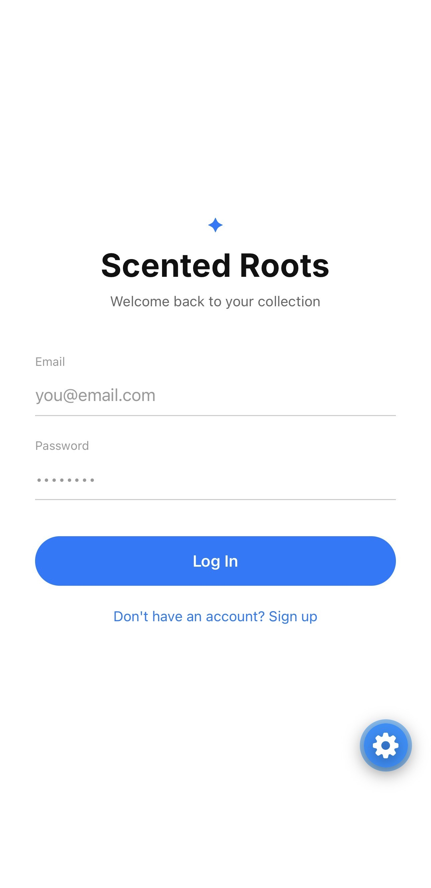
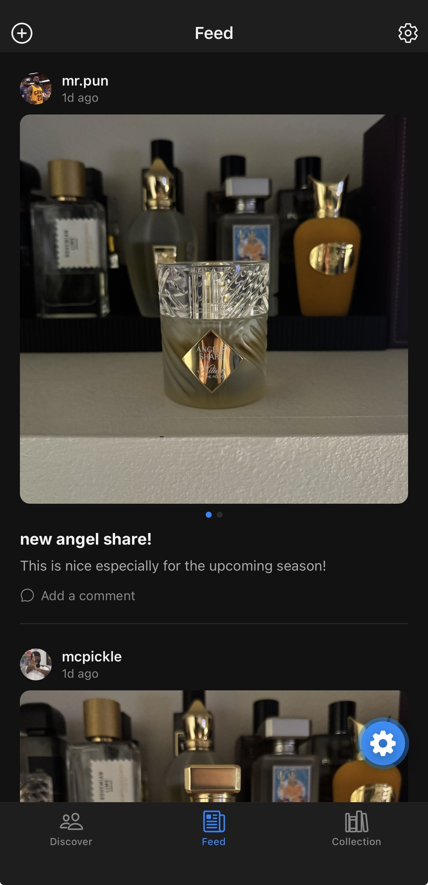
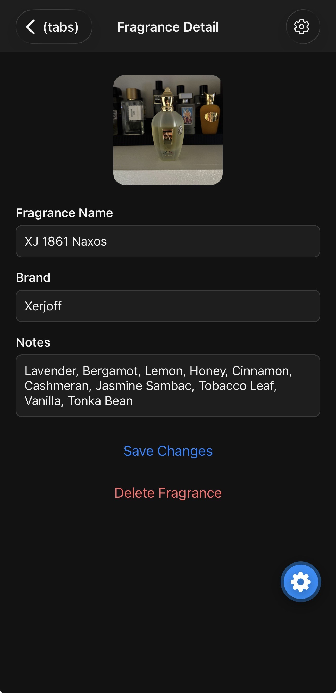
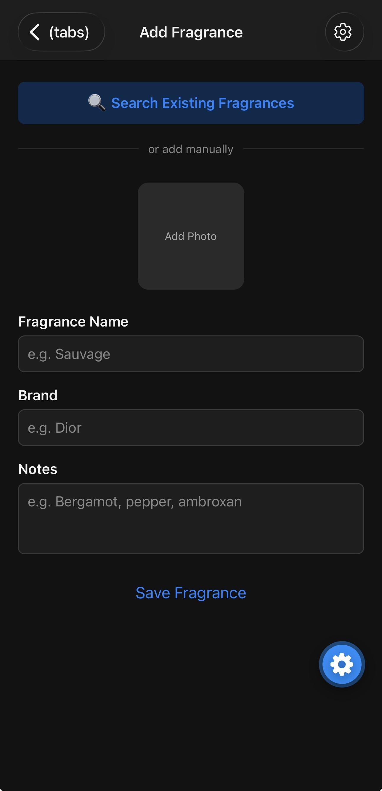
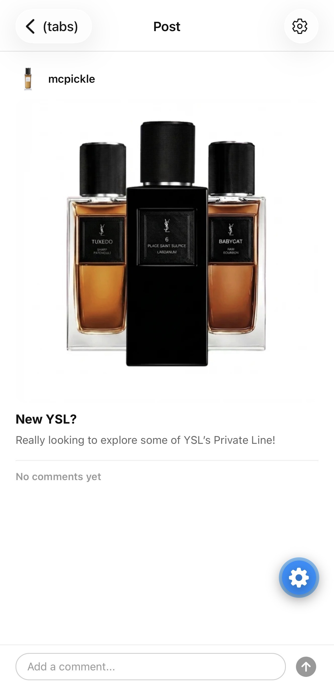

# Scented Roots 🌿

A social mobile app for cataloging, tracking, and sharing your fragrance collection. I built it as a personal project to learn full-stack mobile development with React Native, TypeScript, and Firebase.

<p align="center">
  
  
  
</p>
<p align="center">
  
  
</p>

## Features

- **Accounts:** email/password sign-up with a Terms checkbox, required email verification, and forgot/reset password, all through Firebase Authentication
- **Personal collection:** add fragrances manually or from the shared catalog, with photos, notes, and full edit/delete support. A grid view filters by scent family (Woody, Fresh, Sweet)
- **Searchable catalog:** about 10,000 entries seeded from a public Kaggle dataset, searchable by name, brand, or note. Detail pages show accords and a top/middle/base note pyramid
- **Social feed:** post about a fragrance with multiple photos (swipeable carousel), a caption, and a description
- **Comments and follows:** comment threads on posts, following other collectors, and follower/following counts on profiles
- **Discover:** search for other collectors and browse their collections
- **Light and dark themes:** follows the system setting or a saved preference
- **Designed in Figma first:** every screen was laid out in Figma in light and dark modes, and the color tokens in `src/constants/theme.ts` match the Figma variables one to one
- **UI polish:** animated splash screen, screen transitions, staggered list fade-ins, skeleton loading states, and press feedback throughout

## Tech Stack

- **App:** React Native, Expo SDK 58, Expo Router (file-based routing), TypeScript
- **Backend:** Firebase Authentication and Cloud Firestore
- **Images:** Cloudinary (unsigned uploads)
- **Animation:** `react-native-reanimated`, `expo-linear-gradient`
- **Tooling:** ESLint (`eslint-config-expo`), React Compiler, EAS Build

## Project Structure

```
src/
  app/                     # Screens. Every file is a route (Expo Router)
    _layout.tsx            # Root stack: auth redirects, email-verification gate, splash
    (tabs)/                # Bottom tabs: Discover, Feed, My Collection (index.tsx)
    detail/[id].tsx        # Fragrance detail, edit, and delete
    post/[id].tsx          # Post detail and comments
    user/[id].tsx          # Another collector's profile, follow button
    login, signup, terms, verify-email, forgot-password, reset-password
    add-fragrance, catalog-search, add-from-catalog, new-post, profile, settings
  components/              # Shared UI (Avatar, Button, Chip, TextField, PhotoCarousel, ...)
  constants/               # Theme tokens and fonts
  context/ThemeContext.tsx # Light/dark/system preference, saved with AsyncStorage
  hooks/useFollow.ts       # Follow/unfollow state for a profile
  lib/                     # Cloudinary upload helper, scent-family grouping, password reset
  services/                # In-memory caches for the feed and the user's collection
firebaseConfig.ts          # Firebase initialization (reads EXPO_PUBLIC_ env vars)
```

### Data model

| Collection | What it holds |
| --- | --- |
| `users/{uid}` | Profile (display name, bio, photo), follower/following counts, Terms acceptance time |
| `fragrances` | **Both** the shared catalog and personal items. Catalog docs have `status: "approved"` and no `userId`. Personal items have a `userId` and can link back to a catalog entry with `catalogFragranceId` |
| `posts` | Feed posts with photo URLs and a comment count |
| `posts/{id}/comments` | Comments on a post |

## Getting Started

1. Clone the repo and install dependencies:

   ```bash
   git clone https://github.com/MyLastCode/scented-roots.git
   cd scented-roots
   npm install
   ```

2. Copy `.env.example` to `.env` and fill in your own Firebase and Cloudinary values. `.env` is git-ignored.

   ```
   EXPO_PUBLIC_FIREBASE_API_KEY=your_firebase_api_key
   EXPO_PUBLIC_FIREBASE_AUTH_DOMAIN=your_project.firebaseapp.com
   EXPO_PUBLIC_FIREBASE_PROJECT_ID=your_project_id
   EXPO_PUBLIC_FIREBASE_STORAGE_BUCKET=your_project.appspot.com
   EXPO_PUBLIC_FIREBASE_MESSAGING_SENDER_ID=your_sender_id
   EXPO_PUBLIC_FIREBASE_APP_ID=your_app_id
   EXPO_PUBLIC_CLOUDINARY_CLOUD_NAME=your_cloud_name
   EXPO_PUBLIC_CLOUDINARY_UPLOAD_PRESET=your_upload_preset
   ```

3. Start the dev server:

   ```bash
   npx expo start
   ```

4. Before committing, run the checks:

   ```bash
   npx tsc --noEmit
   npx expo lint
   ```

The native splash screen and app icon only show up in a development or production build (`npx eas-cli@latest build --profile development`), not in Expo Go.

## Data Source

The catalog was seeded from the [Fragrantica Perfumes dataset](https://www.kaggle.com/datasets/ledecanteur/fragrantica-perfumes) on Kaggle, ranked by vote count and capped to stay within Firestore's free-tier quota. A separate Node.js script, not included in this repo, did the import, deduplication, and pruning.

## Roadmap

- Refresh the screenshots for the new UI, including dark mode
- Custom app icon
- Two-factor authentication on sign-in
- Real Terms of Service and Privacy Policy (the in-app Terms are placeholder text)
- "Trending this week" row and Follow buttons on Discover
- Moderation queue for user-submitted catalog entries
- Move catalog search to dedicated search infrastructure (for example Algolia or Typesense). It currently filters on the client, which won't scale past the current dataset
