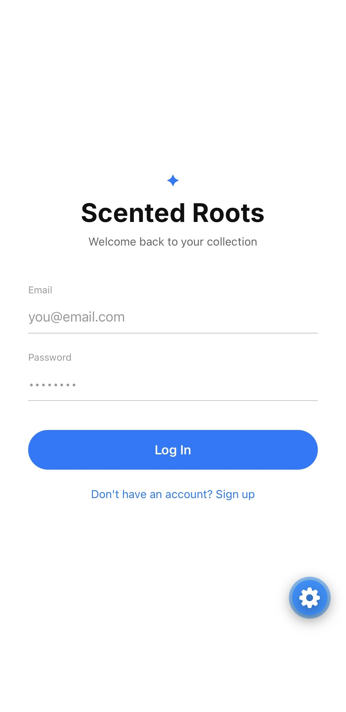
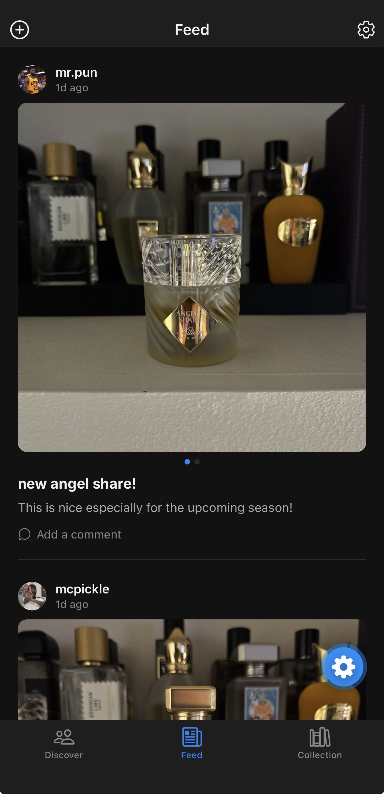
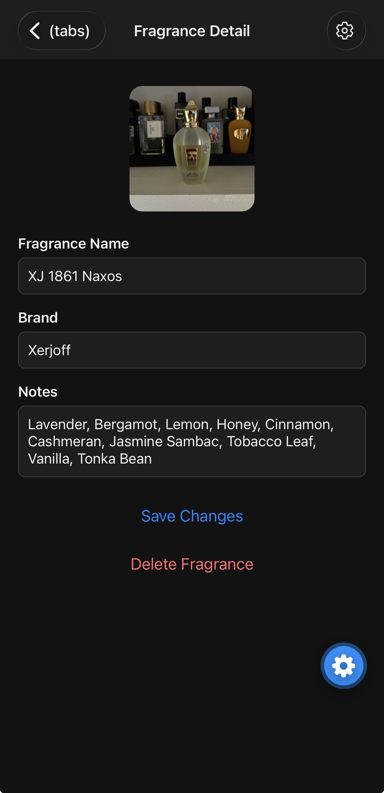
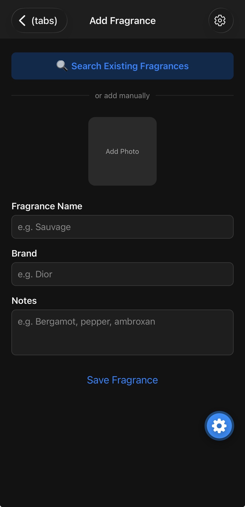

# Scented Roots 🌿

A mobile app for cataloging, tracking, and sharing your fragrance collection — built as a personal project to learn full-stack mobile development with React Native and Firebase.

<p align="center">
  
  
  
</p>
<p align="center">
  
  
</p>

## Features

- **Multi-user accounts** — email/password auth via Firebase Authentication
- **Personal collection** — add fragrances manually or pull them from a shared catalog, with photos, notes, and full edit/delete support
- **Searchable catalog** — seeded from a public Kaggle fragrance dataset (~10,000 entries), searchable by name, brand, or note
- **Social feed** — post about a fragrance with multiple photos (swipeable carousel), caption, and description
- **Comments & follows** — comment threads on posts, follow other collectors, and view follower/following counts on profiles
- **Discover page** — browse other users' collections
- **Light/dark theme** — persisted user preference (system, light, or dark)
- **Polished UI details** — animated screen transitions, staggered list fade-ins, skeleton loading states, and tactile press feedback throughout

## Tech Stack

- **Frontend:** React Native, Expo Router
- **Backend:** Firebase (Authentication, Firestore, Storage)
- **Image hosting:** Cloudinary
- **Data tooling:** Node.js script to import, deduplicate, and prune the catalog from the source dataset

## Project Structure

```
src/
  app/                # Expo Router screens (index, login, profile, settings, etc.)
    detail/[id].tsx    # Fragrance detail, edit, and delete
  constants/           # Theme tokens, fonts
  context/             # ThemeContext (light/dark/system, persisted via AsyncStorage)
firebaseConfig.ts       # Firebase app initialization (db/auth/storage)
fragrance-import/
  import-fragrances.js  # Seeds/prunes the shared catalog from the Kaggle dataset
```

Personal collection items and shared catalog entries live in the same Firestore `fragrances` collection, distinguished by field: catalog docs carry a `status` field and no `userId`; personal items carry a `userId` and no `status`.

## Getting Started

1. Clone the repo and install dependencies:

```bash
   git clone https://github.com/MyLastCode/scented-roots.git
   cd scented-roots
   npm install
```

2. Create a `.env` file in the project root with your own Firebase and Cloudinary values:

```
   EXPO_PUBLIC_FIREBASE_API_KEY=your_key
   EXPO_PUBLIC_FIREBASE_AUTH_DOMAIN=your_project.firebaseapp.com
   EXPO_PUBLIC_FIREBASE_PROJECT_ID=your_project_id
   EXPO_PUBLIC_FIREBASE_STORAGE_BUCKET=your_project.appspot.com
   EXPO_PUBLIC_FIREBASE_MESSAGING_SENDER_ID=your_sender_id
   EXPO_PUBLIC_FIREBASE_APP_ID=your_app_id
   EXPO_PUBLIC_CLOUDINARY_CLOUD_NAME=your_cloud_name
   EXPO_PUBLIC_CLOUDINARY_UPLOAD_PRESET=your_upload_preset
```

(See `.env.example` for the same template with no real values.)

3. Start the app:

```bash
   npx expo start
```

## Data Source

The fragrance catalog is seeded from the [Fragrantica Perfumes dataset](https://www.kaggle.com/datasets/ledecanteur/fragrantica-perfumes) on Kaggle, ranked by vote count and capped to stay within Firestore's free-tier quota.

## Roadmap

- Add Collection grid, catalog search, and dark-mode screenshots
- Moderation queue for user-submitted catalog entries
- Restrict the feed to followed users (optional)
- Migrate catalog search to dedicated search infrastructure (e.g. Algolia/Typesense) to support the full dataset
